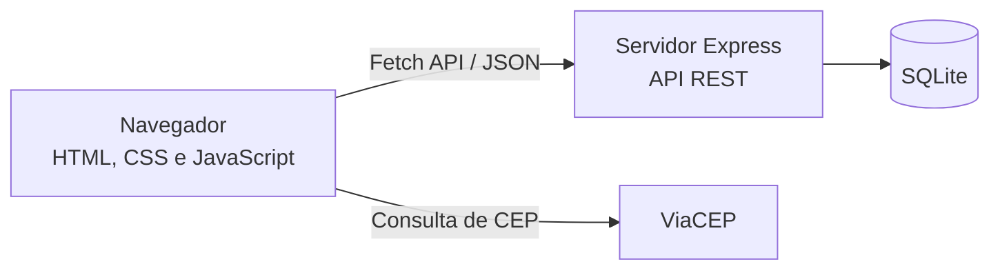

# VIVA — Cidade que Protege

Plataforma web de informação e apoio a mulheres em Recife-PE. Reúne serviços de apoio, orientações sobre direitos e um canal demonstrativo para registrar problemas de segurança urbana, sem necessidade de cadastro e com foco na minimização da coleta de dados pessoais.

> **O VIVA não é um serviço de emergência.** Em risco imediato, ligue **190** (Polícia). Para informações e orientações, ligue **180** (Central de Atendimento à Mulher).

Projeto acadêmico da disciplina Desenvolvimento de Aplicações para Internet — UNINASSAU Olinda, 2026.2.

## Funcionalidades

| Área | Descrição |
|---|---|
| Serviços de apoio | Consulta de serviços de apoio às mulheres, com busca, filtros e indicação das fontes oficiais. |
| Orientações | Informações sobre direitos, tipos de violência e canais de ajuda. |
| Meninas e adolescentes | Orientações e indicação de canais especializados de proteção. |
| Registro de problemas urbanos | Formulário em três etapas: descrição, revisão e confirmação, com consulta opcional de CEP. |
| Acompanhamento | Consulta de registros por meio de um código de protocolo. |
| Acessibilidade e privacidade | Saída rápida, ajuste do tamanho do texto, alto contraste, navegação por teclado e uso sem cadastro. |

## Tecnologias

| Camada | Tecnologia |
|---|---|
| Frontend | HTML5, CSS3 e JavaScript (ES6+), sem frameworks |
| Backend | Node.js e Express |
| Banco de dados | SQLite, pelo módulo nativo `node:sqlite` |
| API externa | ViaCEP |
| Segurança | Helmet e Express Rate Limit |
| Versionamento | Git e GitHub, com branches e Pull Requests |

## Arquitetura



O servidor Express disponibiliza os arquivos do frontend e as rotas da API. O SQLite é responsável pela persistência dos dados, enquanto a consulta ao ViaCEP é realizada diretamente pelo navegador.

### Endpoints da API

| Método | Rota | Descrição |
|---|---|---|
| GET | `/api/saude` | Verifica a disponibilidade do servidor. |
| GET | `/api/servicos` | Lista os serviços de apoio ativos. |
| POST | `/api/registros` | Cria um registro e retorna o protocolo. |
| GET | `/api/registros/:protocolo` | Consulta um registro pelo protocolo. |

## Como executar

**Requisitos:** Git, Node.js 24 ou superior e npm.

```bash
git clone https://github.com/analuisa-r/dev_ap_int.git
cd dev_ap_int/desafios/viva/backend
npm ci
npm start
```

Acesse `http://localhost:3000`.

O banco de dados é inicializado automaticamente em `backend/data/` e não faz parte do controle de versão.

## Segurança e privacidade

- Ausência de cadastro e de campos destinados à identificação pessoal.
- Consulta de CEP realizada no navegador, sem armazenamento pelo VIVA.
- Geração de protocolos aleatórios, dificultando tentativas de adivinhação.
- Validação de dados no frontend e no backend, com consultas SQL parametrizadas.
- Cabeçalhos HTTP de segurança, Content Security Policy (CSP) e limitação de requisições.
- Respostas da API sem cache e tratamento de erros sem exposição de detalhes internos.

Essas medidas buscam reduzir riscos, mas não garantem anonimato absoluto. Os registros não devem conter informações pessoais.

## Acessibilidade e desempenho

A interface possui design responsivo, recursos de alto contraste, ajuste do tamanho do texto e navegação por teclado.

A utilização do formato WebP nos banners internos reduziu o tamanho total dessas imagens em aproximadamente 82%, contribuindo para um carregamento mais eficiente.

## Limitações

- O VIVA é um projeto acadêmico demonstrativo. Os registros não são encaminhados a órgãos públicos e não possuem atualização operacional de status.
- Os contatos e horários dos serviços de apoio estão sujeitos a alterações.
- A saída rápida não apaga o histórico de navegação.
- A persistência dos registros depende de armazenamento adequado no ambiente de hospedagem.
- Caso o ViaCEP esteja indisponível, o bairro pode ser informado manualmente.

Como melhoria futura, prevê-se a implementação de um Mapa de Atenção Urbana com informações agregadas por bairro.

## Equipe

- Ana Luísa Rodrigues
- Maria Eduarda Gomes
- Rebeca Souza
- Tales Rodrigo

## Créditos

Imagens e ilustrações geradas com ferramentas de inteligência artificial.

Fontes Manrope e Inter, distribuídas sob a SIL Open Font License.
